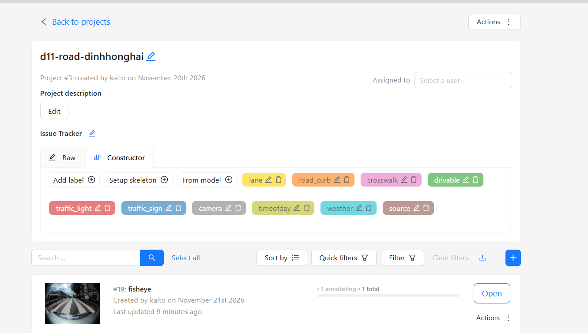
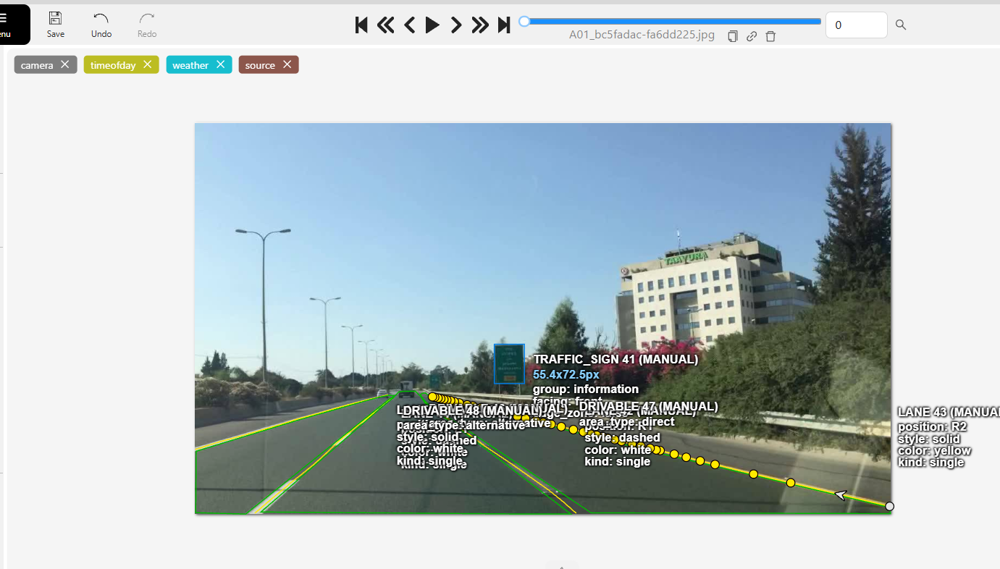
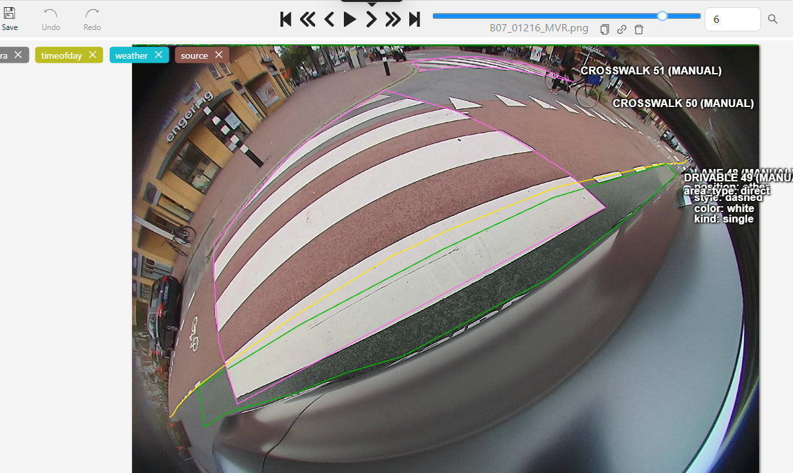
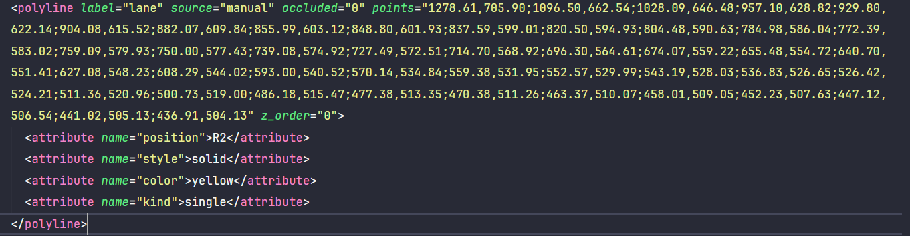

# Báo cáo cá nhân — Ngày 11

Họ tên: Đinh Hồng Hải               Mã học viên: 03096  
Phiên bản CVAT (Help → About): v2.81  
Guideline: Road v1.0    Lần nộp (`revision` trong manifest): 1  
Thời điểm export (ngày giờ trên CVAT): 2026-11-21 11:43 (GMT+7)    Số lần nộp lại sau Rework: 0  

## 1. Kiểm project

| Mục | Đúng như guideline Road v1.0? | Ghi chú |
| --- | --- | --- |
| 6 label, đúng kiểu | Đúng | `lane` (polyline), `road_curb` (polyline), `crosswalk` (polygon), `drivable` (polygon), `traffic_light` (rectangle), `traffic_sign` (rectangle) |
| Thuộc tính và giá trị | Đúng | Nạp trực tiếp từ `configs/road_v1_labels.json` vào tab Raw |
| 4 tag ảnh | Đúng | `camera`, `timeofday`, `weather`, `source`, mỗi tag có thuộc tính select `value` |

Cách kết thúc polyline trên bản CVAT này: Bấm phím `N` (hoặc bấm nút Done trên thanh công cụ).  
Cách đặt tag ảnh trên bản CVAT này: Chọn công cụ Setup tag ở thanh bên trái, thêm từng label tag (`camera`, `timeofday`, `weather`, `source`), sau đó mở **Details** trong bảng **Objects** bên phải để chọn đúng giá trị `value`.  

## 2. Số lượng đã gán

| Task | Ảnh | lane | road_curb | crosswalk | drivable | traffic_light | traffic_sign |
| --- | ---: | ---: | ---: | ---: | ---: | ---: | ---: |
| front | 12 | 28 | 0 | 2 | 25 | 12 | 6 |
| front-extra (đã làm 0 / 4) | 0 | 0 | 0 | 0 | 0 | 0 | 0 |
| fisheye | 8 | 6 | 0 | 8 | 8 | 1 | 2 |
| fisheye-extra (đã làm 0 / 4) | 0 | 0 | 0 | 0 | 0 | 0 | 0 |

## 3. Bảng ca khó

| Ảnh | Nhãn | Phân vân giữa | Đã chọn | Lý do |
| --- | --- | --- | --- | --- |
| A05, A06, A07, A09 | `lane` (L1/R1) | Tự suy đoán vẽ thêm L1/R1 hay bỏ qua khi không thấy vạch | Không vẽ vạch bị thiếu (`A05` thiếu L1/R1; `A06`, `A09` thiếu R1; `A07` thiếu L1) | Theo guideline Road v1.0, không tự vẽ bịa vạch mà ảnh không thấy rõ; ghi chú để coach xác nhận miễn cảnh báo `QC1-02` khi chạy `lint`. |
| B03, B04 | `lane` (`fisheye_rear`) | Đảo trái/phải theo hướng xe chạy hay lấy trái/phải theo khung ảnh | Lấy theo khung ảnh (`L1` bên trái ảnh, `R1` bên phải ảnh) | Nhất quán với góc nhìn trực quan của ảnh và bộ GT mẫu `synthetic.py` trong repo. |
| B04 | `traffic_sign` | Bật hay tắt `edge_zone` cho biển ở góc trên phải `(1059, 159)` | Tắt (`false`) ở bản r1 | Tâm box nằm sát rìa ngoài vòng ảnh (> 80 % bán kính theo cảnh báo `road_check lint`), giữ nguyên bản nộp r1 và ghi nhận ở mục QC 1 để rút kinh nghiệm. |
| B06, B08 | `drivable` (`MVL`/`MVR`) | Chia `direct` / `alternative` hay gộp thành 1 polygon `direct` | Gán 1 polygon `direct` bám sát mép thân xe mình | Camera nhìn ngang hông xe không có vạch chia làn cùng chiều tách biệt rõ ràng; cắt dừng sát đường cong thân xe để không tràn vào thân xe mình. |

## 4. Phiếu QC 1 nhận được

Bạn kiểm lô của tôi: Đinh Hồng Hải (tự kiểm bằng `road_check lint` & Phiếu QC 1 — chưa ghép cặp)  Quyết định nhận được: Hold  

| Mã lỗi | Số lỗi | Đồng ý? | Đã sửa? |
| --- | ---: | --- | --- |
| QC1-01 (nhẹ — thiếu 3 tag `timeofday`, `weather`, `source` ở `B03`) | 3 | Đồng ý | Chưa (giữ nguyên bản r1) |
| QC1-11 (chính — chưa bật `edge_zone` ở `B04` `traffic_sign#1@(1059,159)`) | 1 | Đồng ý | Chưa (giữ nguyên bản r1) |
| QC1-02 (ca chờ lead — thiếu L1/R1 ở `A05`, `A06`, `A07`, `A09`) | 5 cảnh báo lint | Chờ coach xác nhận | Không vẽ thêm theo quy tắc không vẽ bịa vạch |

## 5. Kiểm file export

| File | Mở lại được? | Số shape ảnh 1 (job / file) | Số shape ảnh 2 (job / file) | Tag camera có trong XML? |
| --- | --- | --- | --- | --- |
| `dinhhonghai-front.zip` | Có (`contains_images: false`) | 8 / 8 (`A01`) | 6 / 6 (`A02`) | Có (`front`, đủ 12/12 ảnh) |
| `dinhhonghai-fisheye.zip` | Có (`contains_images: false`) | 2 / 2 (`B01`) | 2 / 2 (`B02`) | Có (đủ 8/8 ảnh; *lưu ý `B03` đang thiếu 3 tag còn lại*) |

*(Ghi chú: Đối chiếu lại số shape trên giao diện job CVAT cho ảnh 1 và ảnh 2 để xác nhận khớp hoàn toàn với số shape đọc từ file XML).*

## 6. Ảnh chụp màn hình

1. Tab Labels của project:

   

2. Một ảnh camera trước đã gán đủ (làn, vùng lái, đèn/biển — gợi ý chụp ảnh `A08` hoặc `A12`):

   

3. Một ảnh fisheye đã gán, phóng to đoạn polyline cong (gợi ý chụp `B03`, `B04` hoặc `B06`):

   

4. Một đoạn XML có `<polyline label="lane">`:

   

   Trích nguyên văn từ `dinhhonghai-front.zip` (`annotations.xml`, ảnh `A01_bc5fadac-fa6dd225.jpg`):
   ```xml
   <polyline label="lane" source="manual" occluded="0" points="1278.61,705.90;1096.50,662.54;1028.09,646.48;957.10,628.82;929.80,622.14;904.08,615.52;882.07,609.84;855.99,603.12;848.80,601.93;837.59,599.01;820.50,594.93;804.48,590.63;784.98,586.04;772.39,583.02;759.09,579.93;750.00,577.43;739.08,574.92;727.49,572.51;714.70,568.92;696.30,564.61;674.07,559.22;655.48,554.72;640.70,551.41;627.08,548.23;608.29,544.02;593.00,540.52;570.14,534.84;559.38,531.95;552.57,529.99;543.19,528.03;536.83,526.65;526.42,524.21;511.36,520.96;500.73,519.00;486.18,515.47;477.38,513.35;470.38,511.26;463.37,510.07;458.01,509.05;452.23,507.63;447.12,506.54;441.02,505.13;436.91,504.13" z_order="0">
     <attribute name="position">R2</attribute>
     <attribute name="style">solid</attribute>
     <attribute name="color">yellow</attribute>
     <attribute name="kind">single</attribute>
   </polyline>
   ```

## 7. Tự đánh giá

Lỗi bạn mắc nhiều nhất hôm nay (theo mã QC1-xx), và cách tránh ở Ngày 20:  
Lỗi dễ gặp nhất là thiếu tag ảnh phụ trên ảnh fisheye (`QC1-01` nhẹ ở `B03` thiếu `timeofday`, `weather`, `source`) và quên kiểm tra `edge_zone` cho biển báo sát viền ảnh fisheye (`QC1-11` ở `B04`), bên cạnh việc cần kiểm tra kỹ các ảnh không có đủ L1/R1 (`QC1-02`). Ở Ngày 20, cách tránh là luôn gắn đủ 4 tag ngay khi mở ảnh mới, rà lại bảng **Details** của từng box ở vùng rìa fisheye, và chạy `road_check lint` trước khi đóng job.

Nhãn của bạn đi vào model ở đâu? Chọn một lỗi đã sửa và nói nó làm model học sai thế nào:  
Nhãn `lane` (polyline) đi vào nhánh phát hiện làn đường (Lane Detection / LKA — giữ làn), nhãn `drivable` đi vào nhánh phân đoạn vùng lái được, còn `traffic_light` / `traffic_sign` (kèm `edge_zone`) đi vào bộ phát hiện vật thể 2D cho hệ thống lập kế hoạch và cảnh báo. Nếu mắc lỗi `QC1-11` không bật `edge_zone` ở rìa ảnh fisheye hoặc vẽ polyline không bám sát cung cong, model đánh giá/huấn luyện sẽ gộp sai các đối tượng bị méo nặng ở viền vào nhóm trung tâm (làm sai lệch phân phối đánh giá ở vùng méo) và làm model giữ làn (LKA) dự đoán lệch quỹ đạo làn đường khi xe vào cua hoặc chuyển làn.

## 8. (Tùy chọn, buffer) Từ polyline đến đích row-anchor

*(Số liệu tham khảo từ `road_lab.rowanchor dinhhonghai-front.zip --image A01 --position R1`, không tính điểm)*

| y | 720 | 680 | 640 | 600 | 560 |
| --- | ---: | ---: | ---: | ---: | ---: |
| x của chúng tôi (`A01`, `R1`) | không có làn | 656.0 | 600.0 | 541.0 | 485.3 |
| x của bạn kia | | | | | |

Trả lời 3 câu:

1. Năm số x đó chính là đích mà một model row-anchor học cho vạch này. Nếu bạn dừng polyline sớm 40 px, hàng nào đổi thành "không có làn"? *(Hàng xa nhất nằm ngoài đoạn polyline bị cắt sớm — ví dụ `y = 560` — sẽ đổi thành "không có làn"; tương tự nếu điểm đầu gần xe bắt đầu ở `y = 718` thay vì chạm đáy `720` thì hàng `y = 720` cũng thành "không có làn").*
2. So với bạn được kiểm (cùng ảnh): ở hàng 720 và hàng 560, hai bạn lệch nhau bao nhiêu pixel? Lệch ở hàng nào ảnh hưởng LKA nhiều hơn (slide 25)? *[Điền độ lệch sau khi so với bạn kia; lệch ở hàng gần xe như `y = 720` / `680` ảnh hưởng trực tiếp tức thời tới góc lái LKA hơn].*
3. Nếu polyline vẽ từ xa về gần (ngược quy tắc 2), cách tính trên có đổi không? Script nào sẽ gặp khó? *(Nội suy tuyến tính giao điểm với từng hàng `y` không đổi giá trị x, nhưng các script đọc điểm đầu là điểm gần xe — như `road_check` kiểm chiều vẽ `QC1-04` hay pipeline quy ước thứ tự điểm từ gần ra xa — sẽ báo lỗi hoặc xử lý sai thứ tự).*
